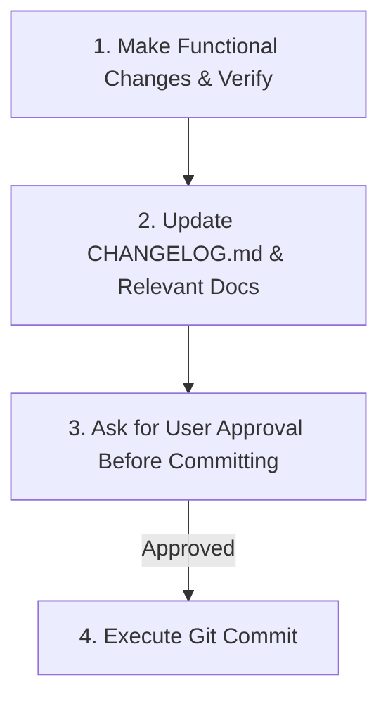

# Agent Guidelines for `cli-code` (UI-licious CLI)

This document defines mandatory instructions, workflows, and conventions for all AI coding agents and developers working within the `cli-code` repository.

---

## 1. Mandatory Development Workflow

Every task or feature implemented MUST follow this exact 3-step sequence:



### Step 1: Make Changes & Verify
- Implement the requested feature, bug fix, or refactoring in `src/`.
- Ensure changes are compatible with Node.js >= 10.0.0 and adhere to standard JavaScript conventions.
- Test the CLI behavior locally:
  ```bash
  node ./src/uilicious-cli.js <command> [args]
  # or
  npm run cli -- <command> [args]
  ```
- **Stage Only Relevant Changes**: Only stage files that are directly related to the current task (`git add <files>`). Avoid staging unintended whitespace or formatting changes to unrelated files.

### Step 2: Update Changelog and Relevant Docs
- **`CHANGELOG.md` Rules**:
  - **ONLY log changes to functional code** (features, bug fixes, refactorings, CLI commands/flags, dependency updates, breaking changes).
  - **DO NOT log documentation-only changes** (e.g., edits solely to `readme.md`, `AGENTS.md`, docstrings, or internal comments).
  - Keep changelog entries **concise** and categorized under `## [Unreleased]` (e.g., `### Added`, `### Changed`, `### Fixed`, `### Deprecated`, `### Removed`).
- **Documentation**:
  - Keep [`readme.md`](readme.md) synchronized if CLI commands, options/flags, environment variables, or usage behaviors are updated.
- **No Machine/User-Specific File Paths (STRICT)**:
  - **NEVER** include local machine paths (e.g., `/Users/...`, `/home/...`, `C:\...`, `~`) in documentation, comments, or source code.
  - Always use **repository-relative paths** (`src/uilicious-cli.js`, `src/cli-command/project/run.js`, `readme.md`).

### Step 3: Commit Changes (Always Ask for Approval First - MANDATORY)
- **NEVER execute `git commit` automatically without explicit user approval.**
- Before committing:
  1. Show a clear summary of all modified/staged files.
  2. Propose the commit message (following Conventional Commits, e.g., `feat: ...`, `fix: ...`, `refactor: ...`, `chore: ...`).
  3. Explicitly ask the user for approval to execute the commit.
- Execute `git commit` only after receiving explicit confirmation from the user.

---

## 2. Git & Repository Information

- **Git Remote**: `git@gitlab.uilicious-dev.com:uilicious/cli-code.git`
- **Default Branch**: `main`

---

## 3. Project Architecture & Codebase Layout

- **Entry Point**: [`src/uilicious-cli.js`](src/uilicious-cli.js) — CLI bootstrapping and top-level command routing via `sywac`.
- **Core Setup & Handlers**:
  - [`src/MainSywac.js`](src/MainSywac.js) — Configures the `sywac` instance with styles and global settings.
  - [`src/ArgumentValidator.js`](src/ArgumentValidator.js) — Validates common arguments (authentication, `--apiHost`, deprecated flags).
  - [`src/OutputHandler.js`](src/OutputHandler.js) — Manages terminal output formatting, JSON output modes (`--jsonOutput`, `--jsonOutputFile`), error handling, and exit codes.
  - [`src/version.js`](src/version.js) — Single source of version string exported for CLI banner and metadata.
- **CLI Commands (`src/cli-command/`)**:
  - `project/` — Project operations: `run.js`, `upload.js`, `download.js`, `list.js`, `filelist.js`, `concurrency.js`.
  - `job/` — Test execution jobs: `start.js`, `list.js`, `history.js`.
  - `space/` — Space/workspace operations: `list.js`.
- **API & Networking (`src/api/`)**:
  - `ApiServerConnector.js` — HTTP client wrapper connecting to the UI-licious REST API, managing session tokens, headers, and proxy configs (`http_proxy` / `https_proxy`).
  - `SpaceAndProjectApi.js` — API helper methods for spaces, projects, test runs, and file management.
  - `retryForResult.js` — Exponential backoff and retry helper for polling job results.
- **Utilities (`src/util/`)**:
  - `FileUtil.js` — File system utilities for zip archiving, file discovery, and downloads.
  - `FormatShift.js` — Data transformation helpers for tabular and JSON terminal outputs.
- **Binary Packaging**:
  - [`pkg-build.sh`](pkg-build.sh) — Builds standalone multi-platform executable binaries via `pkg`.
