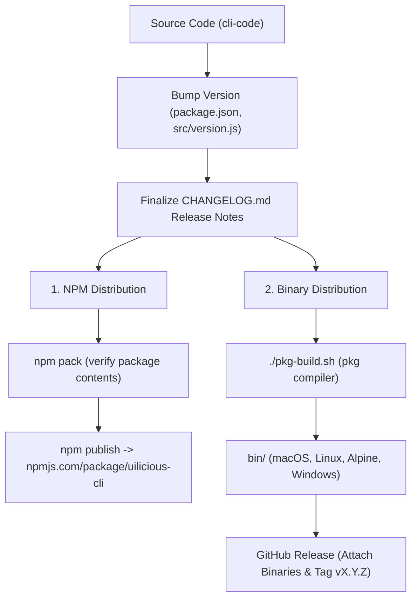

# Release & Deployment Guide

This document outlines the end-to-end process for packaging, distributing, and deploying `uilicious-cli` (`cli-code`) across both distribution channels:
1. **NPM Registry Distribution** — Standard Node.js package (`npm install -g uilicious-cli`).
2. **Standalone Binary Distribution** — Single-file executable binaries for macOS, Linux, Alpine, and Windows uploaded to GitHub Releases.

---

## 1. Overview of Distribution Channels



---

## 2. Versioning Strategy & Pre-Release Checklist

The project strictly follows [Semantic Versioning (SemVer)](https://semver.org/spec/v2.0.0.html) (`MAJOR.MINOR.PATCH`).

### Files Requiring Version Updates
Before releasing a new version, ensure the version string is synchronized in:

| File | Location / Key | Description |
|---|---|---|
| [`package.json`](../package.json) | `"version": "X.Y.Z"` | Package manifest version used by NPM and packaging tools |
| [`src/version.js`](../src/version.js) | `module.exports = "X.Y.Z"` | CLI internal runtime version outputted in `uilicious-cli -v` |
| [`CHANGELOG.md`](../CHANGELOG.md) | `## [X.Y.Z] - YYYY-MM-DD` | Convert `[Unreleased]` changes into the dated release header |

### Pre-Release Verification Checklist
- [ ] Clean working tree with no unstaged/uncommitted functional changes.
- [ ] Dependencies are locked in `package-lock.json` (`npm ci` or `npm install`).
- [ ] Syntax check passes:
  ```bash
  node ./src/uilicious-cli.js --help
  node ./src/uilicious-cli.js --version
  ```
- [ ] Run test suite / verification scripts to ensure core commands operate correctly.

---

## 3. Packaging & Publishing to NPM

### Step 1: Verify Package Contents Locally
Check which files will be included in the NPM bundle by creating a tarball:
```bash
npm pack --dry-run
```
Or generate the tarball file and inspect its contents:
```bash
npm pack
tar -tf uilicious-cli-*.tgz
```

> [!NOTE]
> The `.npmignore` file controls which directories are omitted from the NPM tarball. Directories such as `bin/`, `dist-repos/`, `node_modules/`, and `.git/` are excluded.

### Step 2: Publish to NPM
Authenticate to NPM if not already logged in:
```bash
npm login
```

Publish the release:
```bash
# Standard latest release
npm publish

# Or publish under a beta/next tag if pre-releasing
npm publish --tag next
```

### Step 3: Verify NPM Release
Verify that the published version is available globally:
```bash
# Check registry metadata
npm view uilicious-cli version

# Test execution via npx
npx uilicious-cli@latest --version
```

---

## 4. Standalone Binary Compilation (`pkg-build.sh`)

UI-licious packages standalone binary executables that bundle the Node.js runtime, CLI code, and all required dependencies into a single binary. Target machines do not need Node.js or NPM installed.

### Build Script Configuration
The compilation script [`pkg-build.sh`](../pkg-build.sh) uses `@vercel/pkg` to produce binaries across operating systems and CPU architectures:

```bash
#!/bin/bash
set -euo pipefail

# Cleanup destination folder
mkdir -p ./bin
rm -f ./bin/uilicious-*

COMMA=","
TARGET_MACOS="node16-macos-x64,node16-macos-arm64"
TARGET_LINUX="node16-linux-x64,node16-linux-arm64"
TARGET_ALPINE="node16-alpine-x64"
TARGET_WINDOWS="node16-win-x64"

TARGET_ALL=$TARGET_MACOS$COMMA$TARGET_LINUX$COMMA$TARGET_ALPINE$COMMA$TARGET_WINDOWS

# Run pkg build
npx --package "pkg@5.3.1" \
    pkg ./src/uilicious-cli.js \
    --options max_old_space_size=2048 \
    --no-bytecode --public-packages "*" --public \
    --out-path ./bin/ \
    --target $TARGET_ALL
```

### Target Platform Matrix

| Platform | Architecture | `pkg` Target Identifier | Generated Output File |
|---|---|---|---|
| **macOS** | x64 (Intel) | `node16-macos-x64` | `bin/uilicious-cli-macos-x64` |
| **macOS** | arm64 (Apple Silicon / M-series) | `node16-macos-arm64` | `bin/uilicious-cli-macos-arm64` |
| **Linux** (glibc) | x64 | `node16-linux-x64` | `bin/uilicious-cli-linux-x64` |
| **Linux** (glibc) | arm64 / aarch64 | `node16-linux-arm64` | `bin/uilicious-cli-linux-arm64` |
| **Alpine Linux** (musl) | x64 | `node16-alpine-x64` | `bin/uilicious-cli-alpine-x64` |
| **Windows** | x64 | `node16-win-x64` | `bin/uilicious-cli-win-x64.exe` |

### Key `pkg` Compiler Flags Explained
- `--options max_old_space_size=2048`: Allocates 2GB max heap memory to the embedded Node runtime to prevent out-of-memory errors on large test suite uploads.
- `--no-bytecode`: Disables bytecode pre-compilation to prevent V8 snapshot incompatibilities across minor CPU differences.
- `--public-packages "*"` and `--public`: Ensures all bundled modules remain publicly accessible in the virtual filesystem structure required by dynamic require loaders.
- `--out-path ./bin/`: Directs generated executables into the local `bin/` directory.

### Running the Local Build
```bash
# Make build script executable (if needed)
chmod +x ./pkg-build.sh

# Execute binary build
./pkg-build.sh
```

---

## 5. GitHub Releases Distribution

Once binaries are generated, they are uploaded directly to the GitHub Release corresponding to the release tag.

### Step 1: Create and Push Git Release Tag
```bash
# Create annotated tag
git tag -a vX.Y.Z -m "Release vX.Y.Z"

# Push tag to GitHub remote
git push origin vX.Y.Z
```

### Step 2: Create GitHub Release and Upload Assets

#### Option A: Using the GitHub CLI (`gh`)
```bash
gh release create vX.Y.Z \
    ./bin/* \
    --title "vX.Y.Z" \
    --notes-file <(sed -n '/## \[X.Y.Z\]/,/## \[/p' CHANGELOG.md | sed '$d')
```

#### Option B: Via GitHub Web Interface
1. Navigate to **Releases** > **Draft a new release**.
2. Select the tag `vX.Y.Z`.
3. Set the release title to `vX.Y.Z`.
4. Copy the release notes corresponding to version `X.Y.Z` from [`CHANGELOG.md`](../CHANGELOG.md).
5. Drag and drop all compiled binaries from the `bin/` directory into the release assets uploader.
6. Click **Publish release**.

---

## 6. Continuous Integration & Automated Builds

The repository includes a GitHub Actions workflow at [`.github/workflows/build.yml`](../.github/workflows/build.yml) that builds binaries on every push to main branches:

```yaml
name: Core Binary Build
on:
  push:
    branches: [ nodejs-release, main, master ]
  pull_request:
    branches: [ main, master ]
jobs:
  build:
    runs-on: macos-11
    steps:
    - uses: actions/checkout@v2
    - uses: actions/setup-node@v2
      with:
        node-version: '14'
    - name: Cache Node packages
      uses: actions/cache@v2
      with:
        key: ${{ runner.os }}-build-${{ env.cache-name }}-${{ hashFiles('package-lock.json') }}
        path: |
          ./node_modules
    - name: Setup dependencies
      run: npm install
    - name: Build the packages
      run: ./pkg-build.sh
    - name: Archive binary files
      uses: actions/upload-artifact@v2
      with:
        name: binary-files
        path: |
          bin/*
```

Workflow artifacts named `binary-files` can be downloaded directly from GitHub Actions build runs for testing or release staging.

---

## 7. Post-Deployment Smoke Tests

After releasing to NPM and GitHub Releases, perform quick smoke tests across environments:

```bash
# 1. NPM Global Install Smoke Test
npm install -g uilicious-cli@latest
uilicious-cli --version

# 2. Binary Direct Execution Test (e.g. Linux / macOS)
chmod +x ./uilicious-cli-linux-x64
./uilicious-cli-linux-x64 --version
./uilicious-cli-linux-x64 --help

# 3. Windows Execution Test (PowerShell / Command Prompt)
.\uilicious-cli-win-x64.exe --version
.\uilicious-cli-win-x64.exe --help
```
